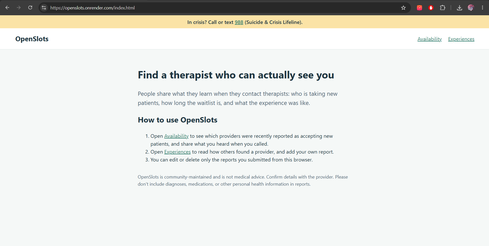
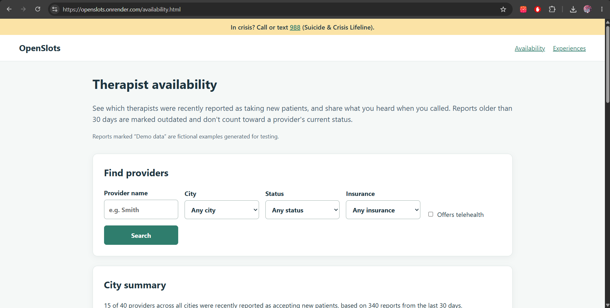
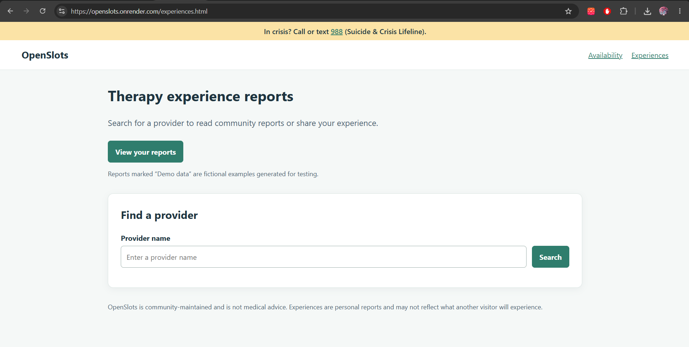

# OpenSlots: Therapist Availability & Experience Guide

**Authors:** Ankita Mandalam and Agilan Balaraman

**Class:** [CS 5610 Web Development](https://johnguerra.co/classes/webDevelopment_online_fall_2026/)

**Live site:** [https://openslots.onrender.com/](https://openslots.onrender.com/)

**Demo video:** yet to add video link

**Design document:** [design-docs/design-document.md](design-docs/design-document.md)

## Project objective

OpenSlots helps people looking for mental health care find therapists who are
actually accepting new patients, and read community experience reports about
those providers.

### Availability reports

Users can browse providers by name, city, insurance, telehealth, and accepting
status. Each provider shows its current status, taken from the most recent
report from the last 30 days. Older reports stay in the provider's history but
are labeled **Outdated**. A city summary, calculated through MongoDB
aggregation, shows how many providers were recently reported as accepting new
patients and how many reports that is based on.

Users can submit, edit, and delete their own availability reports.

### Therapy experience reports

Users can search for a provider and browse reports by therapy type, visit
format, rating, and recommendation. Each provider displays an average rating
and report count calculated through MongoDB aggregation.

Users can submit, edit, and delete their own reports. The **View your reports**
button provides quick access to reports created from the current browser.

## How to use

### Availability

1. Open **Availability** from the navigation.
2. Filter providers by name, city, status, insurance, or telehealth, and check
   the city summary.
3. Select **View and report** on a provider to see its current status and
   report history.
4. Complete the form to report what you heard when you contacted the provider.
5. Edit or delete your own reports from the provider's report history.

### Experiences

1. Open **Experiences** from the navigation.
2. Search for a provider by name and select a result.
3. Browse reports or apply the available filters.
4. Complete the form to submit an experience report.
5. Use **View your reports** to edit or delete reports submitted from the
   current browser.

You can edit or delete only the reports submitted from your own browser. Do not
include diagnoses, medications, treatment outcomes, client names, personal
health information, medical claims, or accusations in reports.

## Screenshot

### Landing Page



### Availability Page



### Experiences Page



## Instructions to build

1. Install Node.js 20.6 or later.
2. Clone the repository and run `npm install`.
3. Copy `.env.example` to `.env` and set `MONGO_URL` and `DB_NAME`.
4. Seed the database with `npm run seed`.
5. Start the server with `npm run dev`.
6. Open http://localhost:3000.

To run the seed scripts separately:

```bash
npm run seed:providers
npm run seed:experiences
npm run seed:availability
```

## Data source

The provider directory contains about 9,000 Massachusetts mental health
providers from the
[CMS Doctors and Clinicians National Downloadable File](https://data.cms.gov/provider-data/dataset/mj5m-pzi6).
It includes clinical social workers, mental health counselors, clinical
psychologists, psychiatrists, and marriage and family therapists enrolled in
Medicare.

The filtered data is already included in `db/seed/data/providers.json`, so you
don't need to download anything to run the project. To rebuild it from a newer
CMS file, download the CSV, keep it outside the project folder, and run:

```bash
node db/seed/buildProviders.js "<path to the CSV>"
```

### Demo data

To make the features easy to try, the seed scripts generate demo data:

- **Experience reports:** 1,000 synthetic reports for testing filters,
  pagination, ratings, and recommendations.
- **Availability reports:** about 1,000 synthetic reports spread over the last
  90 days, so some are recent and some are outdated, for testing current
  status, filters, and the city summary.

All demo reports are attached only to 40 clearly labeled fictional providers
whose names begin with `[DEMO]`, spread across several Massachusetts cities.
They are never attached to real CMS clinicians. The app shows a **Demo data**
badge on every generated report, and visitors cannot edit or delete them. Demo
records are fictional and do not describe real therapists, real availability,
or real patient experiences.

## License

[MIT](LICENSE)
