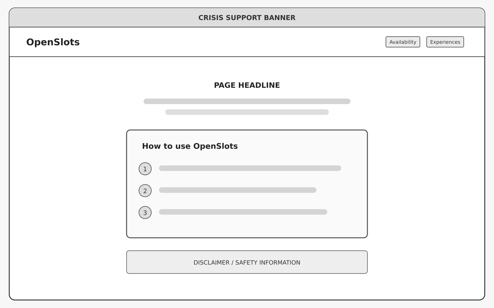
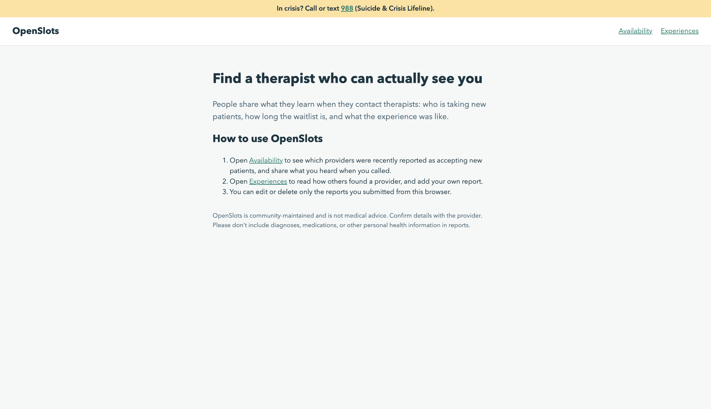
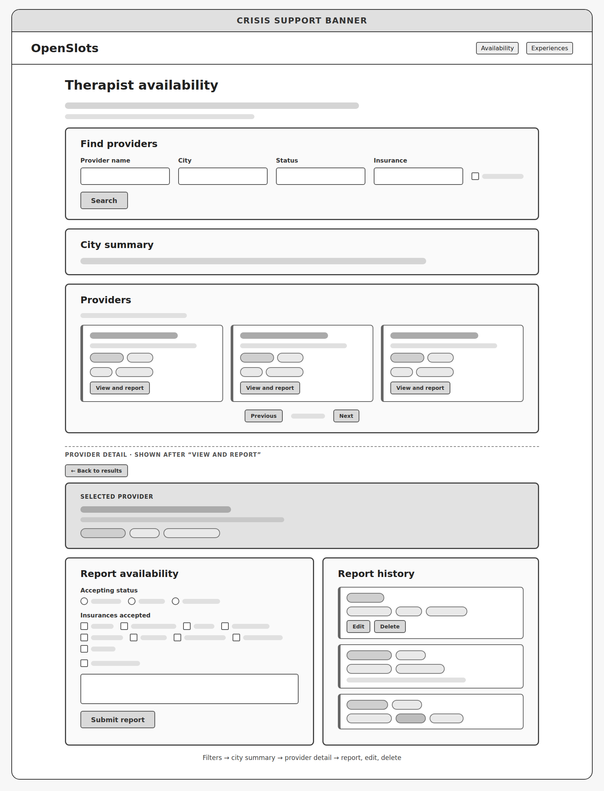
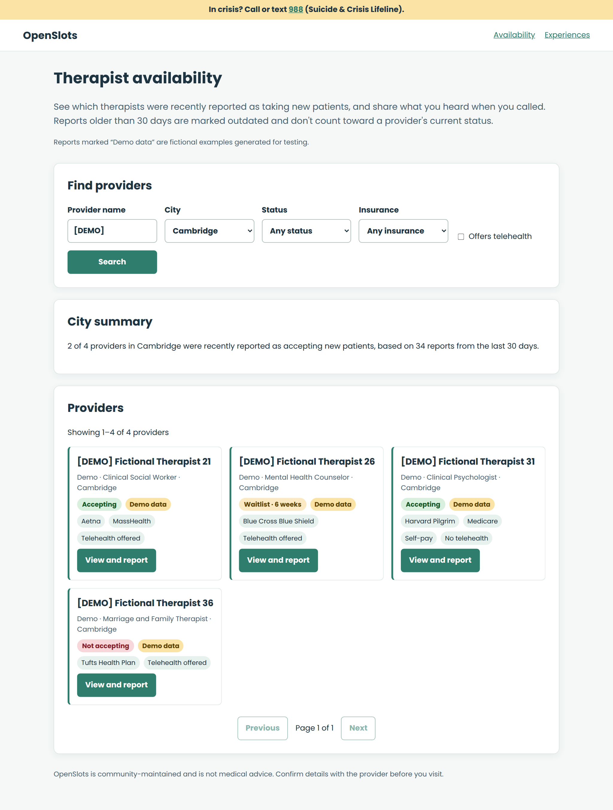
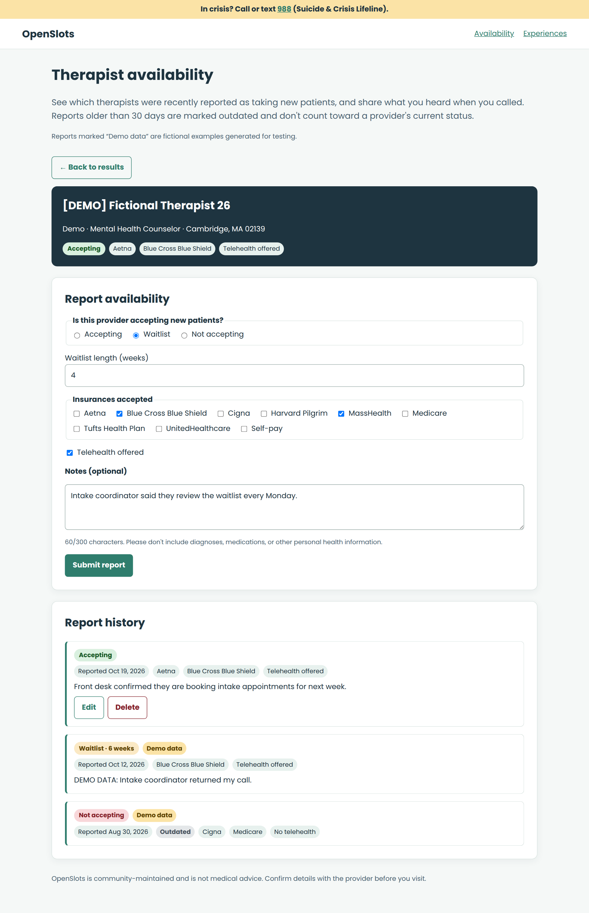
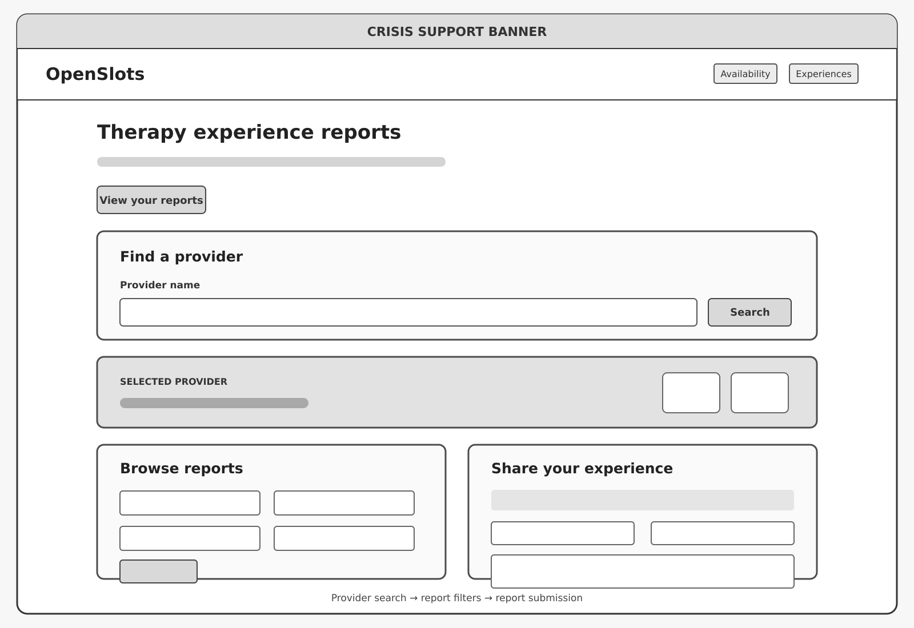
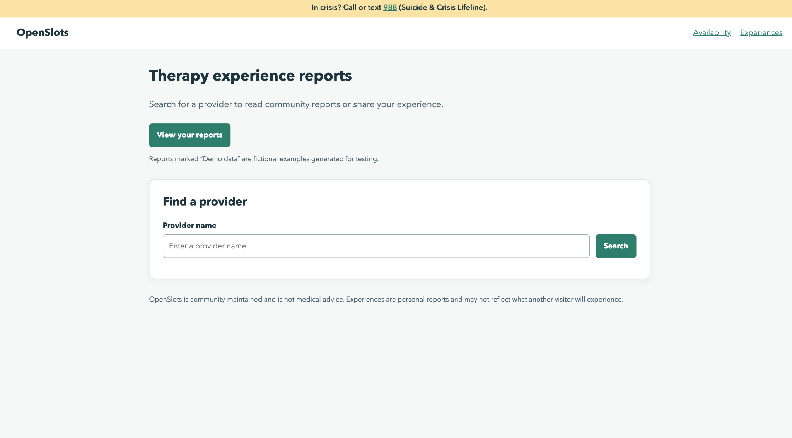

# OpenSlots Design Document

Ankita Mandalam and Agilan Balaraman

## Project description

Finding a therapist often means calling office after office, only to learn that a provider is not taking new patients, has a long waitlist, or no longer accepts your insurance. Online listings are frequently out of date, and they say little about what working with a provider is actually like.

OpenSlots helps people looking for mental health care answer two questions:

1. Which therapists are actually accepting new patients, and how long is the waitlist?
2. What type of therapy have people received from a provider, and what was their experience?

OpenSlots is community-driven: people who contact or visit a provider share what they learned, and others browse and filter those reports. It has two features:

- **Availability Reports:** users report whether a provider is accepting new patients, the waitlist length, accepted insurances, and whether telehealth is offered. Each provider shows its current status from the most recent report in the last 30 days, older reports are labeled Outdated, and a city summary shows how many providers were recently reported as accepting.
- **Therapy Experience Reports:** users report the therapy type, visit format, a 1 to 5 rating, whether they would recommend the provider, and a short summary. Each provider shows its average rating and report count, and reports can be filtered by therapy type, visit format, rating, and recommendation.

Both features use a shared directory of real Massachusetts mental health providers. Users can edit or delete only the reports they submitted. OpenSlots is informational only and not medical advice, and every page shows a crisis banner: "In crisis? Call or text 988 (Suicide & Crisis Lifeline)."

## User personas

**Alex, a newcomer.** Alex just moved to Boston and needs a therapist who accepts Blue Cross and offers telehealth. He's tired of calling practices that turn out to be full.

**Jordan, a contributor.** Jordan has been calling offices and learning which ones have waitlists. He wants to share what he finds so the next person doesn't have to make the same calls.

**Taylor, a couples therapy seeker.** Taylor and their partner are looking for couples therapy and want to read about other people's experiences with that specific type of therapy.

**Morgan, a telehealth user.** Morgan has a busy schedule and only wants online appointments. She wants to compare providers based on telehealth experiences.

**Casey, a past client.** Casey attended therapy with a provider and wants to share a rating and a short summary to help future users.

## User stories

### Availability Reports

**1. Alex filters for providers who can see him.**
Alex has a list of names from his insurer, but doesn't know which ones are taking patients. He opens Availability, chooses Boston, Blue Cross Blue Shield, telehealth, and Accepting. Only providers whose current status matches remain, so he calls those first.

> As Alex, I want to filter therapists by city, insurance, telehealth, and accepting status, so I don't waste time calling full practices.

**2. Jordan reports a waitlist.**
Jordan gets a call back from an office: the therapist has a 6-week waitlist, takes Aetna, and offers telehealth. He opens the provider, selects Waitlist, enters 6 weeks, checks Aetna and telehealth, and submits. His report becomes the provider's current status.

> As Jordan, I want to report a provider's accepting status, waitlist length, insurances, and telehealth availability, so the next person knows before calling.

**3. Jordan fixes a mistake.**
Jordan realizes he checked the wrong insurance. He opens the provider again, finds his report with Edit and Delete buttons, corrects the insurance, and saves. Had he reported the wrong provider, he could delete it instead.

> As Jordan, I want to edit or delete my own reports, so I can fix mistakes like picking the wrong insurance.

**4. Alex decides whether to widen his search.**
Alex checks the city summary for Cambridge to see how many providers were recently reported as accepting, and how many reports that is based on. A report from two months ago is labeled Outdated and doesn't count toward current status, so old information doesn't mislead him.

> As Alex, I want to see each provider's current status and how many therapists in a city are currently accepting patients, so I can decide whether to widen my search. Reports older than 30 days are labeled Outdated and excluded from current status.

### Therapy Experience Reports

**1. Taylor reads only couples therapy reports.**
Taylor finds a provider with many reports, but most are about individual therapy. Taylor filters by therapy type and selects Couples, so only relevant experiences remain.

> As Taylor, I want to filter experience reports by therapy type (Individual, Couples, Family, or Group), so unrelated experiences don't influence my decision.

**2. Morgan compares telehealth providers.**
Morgan only does online appointments. She filters a provider's reports to Telehealth and checks its average rating and report count, then does the same for another provider to compare.

> As Morgan, I want to filter reports by visit format and compare providers' average ratings, so I can find a good telehealth provider.

**3. Casey shares an experience.**
Casey finished several sessions and wants to help others. Casey selects the provider, chooses the therapy type and visit format, gives a rating, says whether they'd recommend the provider, adds a short summary without health details, and submits. The provider's average rating and report count update.

> As Casey, I want to submit an experience report with therapy type, visit format, a 1 to 5 rating, whether I'd recommend the provider, and a short summary, so I can help future users.

**4. Casey corrects a rating.**
Casey notices they entered the wrong rating. Using "View your reports," Casey finds the report, edits the rating, and saves, or deletes it entirely.

> As Casey, I want to edit or delete my own report, so I can correct a wrong rating or remove it.

## Design mockups

### Landing page

### Availability page

The search view holds the filters, city summary, and provider results. "View and report" opens the provider detail view with the current status, report form, and report history.

### Experiences page

Users search for a provider, see its average rating and report count, filter its reports, and share their own experience.

